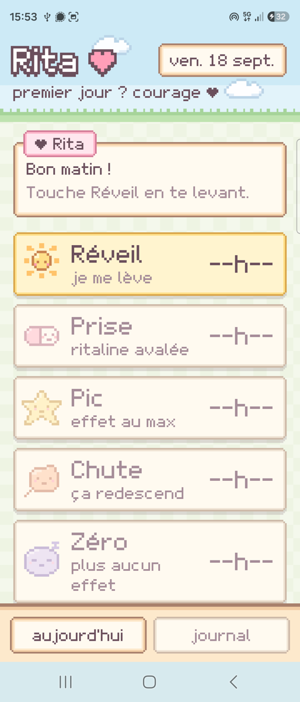
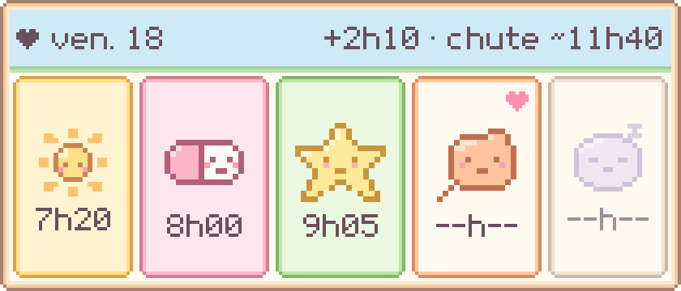
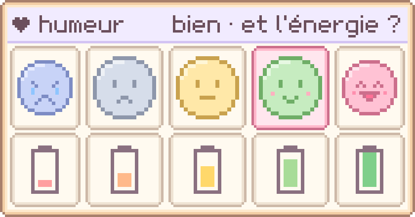

# Rita ♥

> Petit carnet Android pour suivre sa Ritaline et son humeur au quotidien, en pixel art pastel façon vieux Harvest Moon.

  

**[Télécharger l'APK](../../releases/latest)**

<p>
  
  &nbsp;
  
</p>
<p></p>

## À propos

Rita est un carnet de suivi personnel : réveil, prise, pic, chute et zéro effet de la Ritaline, autres traitements, humeur, énergie et crises d'angoisse, avec des widgets pour tout noter en un tap depuis l'écran d'accueil. Tout reste sur le téléphone : aucune connexion internet, aucune sauvegarde cloud.

## Fonctionnalités

- **Rita** : 5 étapes par jour (réveil, prise, pic, chute, zéro effet). Un tap note l'heure, un autre la corrige.
- **Autres traitements** : ajoute tes médicaments (tous les jours ou si besoin), un tap note la prise. Rappel en milieu de journée (13h par défaut) si un médicament n'est pas encore noté.
- **Humeur** : 5 têtes pour l'humeur, 5 piles pour l'énergie, autant de fois que tu veux dans la journée, avec des raisons possibles (tu peux ajouter les tiennes).
- **Crises d'angoisse** : un tap note le début, puis intensité de 1 à 5, symptômes, raisons possibles et ce qui a aidé. Un écran « respirer » (5 s / 5 s) et un raccourci « Crise » sur l'icône (appui long).
- **Quatre widgets** pour l'écran d'accueil : ma journée, une version mini (juste la prochaine étape), humeur, et un petit carré par traitement à toucher une fois le médicament pris. Un tap enregistre, sans ouvrir l'app.
- **Journal** : calendrier du mois, constats en phrases, durée d'effet, courbe type, humeur jour par jour et selon l'heure, humeur selon le contexte, crises par heure, phase et raison. Période 7 jours, 30 jours ou tout.
- **Prévisions** : pic, chute et fin d'effet estimés d'après tes moyennes.
- **Privé** : aucune connexion internet, aucune sauvegarde cloud. Export / import JSON pour garder une copie.

## Installation

Télécharge `Rita-x.y.z.apk` dans les [Releases](../../releases), ouvre-le sur le téléphone et autorise l'installation.
Android 8.0 minimum. Les mises à jour s'installent par-dessus sans perdre les données.

### Compiler

Prérequis : JDK 17, SDK Android (compileSdk 36), Python avec `fonttools` et `Pillow` pour les scripts de `tools/`.

```bash
python tools/make_assets.py      # police pixel, sprites, icône
python tools/widget_preview.py   # aperçus des widgets
./gradlew assembleRelease
```

## Utilisation

- Un tap sur une étape (dans l'app ou sur un widget) note l'heure ; un nouveau tap la corrige.
- Appui long sur l'icône de l'app : raccourci « Crise » pour noter une crise d'angoisse.
- Export / import JSON depuis l'app pour garder une copie de ses données.

## Structure du projet

| Chemin | Contenu |
| --- | --- |
| `app/src/main/assets/www/` | Interface en HTML/CSS/JS (prévisualisable dans un navigateur). `app.js` est le cœur ; `meds.js`, `crises.js` et `journal.js` sont les modules |
| `app/src/main/java/app/ritalog/local/` | Activité Android, widgets (dessinés en Java : `WidgetRenderer.java`, `MoodRenderer.java`…), stockage et rappels |
| `design/sprites.json` | Source des sprites pixel art |
| `tools/make_assets.py` | Génère la police pixel `pixel.ttf`, `sprites.js` et les icônes de lancement |
| `tools/widget_preview.py` | Génère les aperçus des widgets |
| `tools/demo_data.js` | Remplit l'aperçu avec 60 jours de fausses données |
| `docs/` | Captures d'écran du README |

## Stack technique

Java (Android, Gradle, minSdk 26 / targetSdk 36), WebView avec HTML/CSS/JS, Python (fontTools, Pillow) pour la génération des assets. Police et sprites sont faits maison.

## Crédits & licence

Rita est un outil de suivi personnel, pas un dispositif médical. Les questions sur le traitement se posent à ton médecin.

Aucune licence n'est spécifiée — tous droits réservés.

---

<p align="center">
  Fait par <a href="https://github.com/elisalien">Élisalien</a> ·
  <a href="https://gitlab.com/elisalien/catalog">Catalogue des shaders, sources & logiciels</a>
</p>
